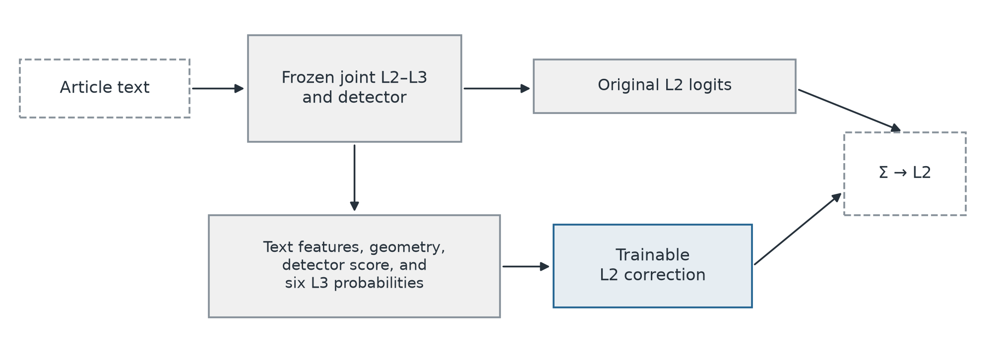
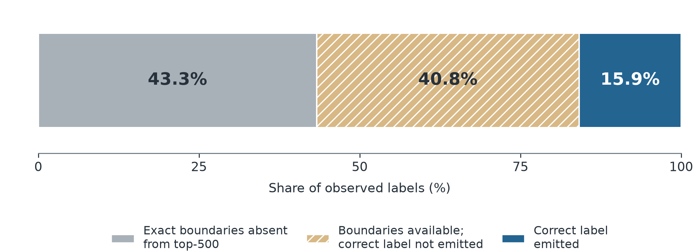
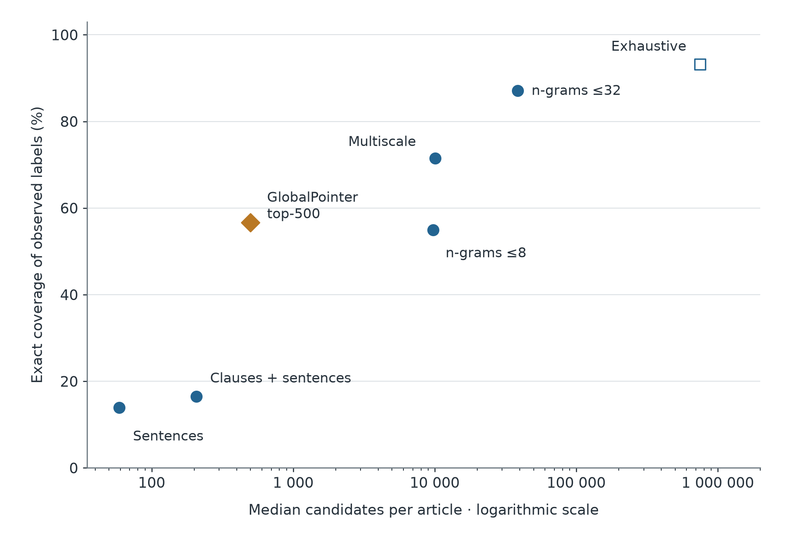
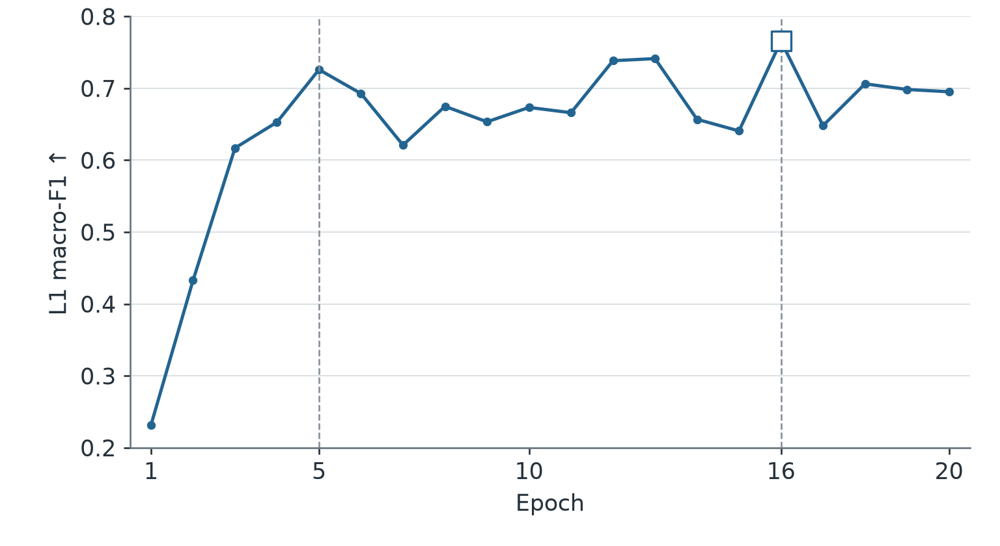
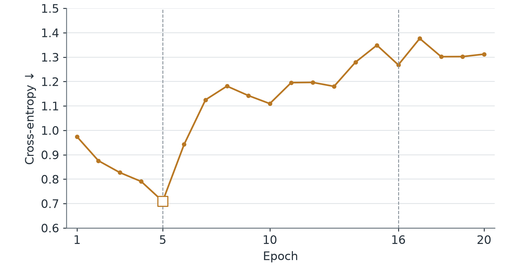

# Modeling Participant Roles, Frames, and Rhetoric in Russian-Language News

## Abstract

The aim of this work is to develop a model that takes a news article and identifies how specified participants are portrayed, which aspects of the event are emphasized, and which passages contain rhetorical techniques. I test whether the results of one task help solve another more accurately. Using the Russian-language KuKi corpus of 207 articles, including 120 documents that I annotated, I developed models for recognizing roles, frames, and rhetoric. The experiments compare independent training, joint training of pairs of tasks, and the use of rhetorical predictions in the frame model. Joint training with frames improved the classification and selection of automatically detected rhetorical spans on held-out articles. Joint training of roles and frames scored worse than the standalone models. Frame prediction improved slightly through interaction with rhetoric, but a statistical advantage was not established.

## 1. Introduction

Comparing news reports requires attention to how a text portrays the participants in an event, which aspects it emphasizes, and which rhetorical devices it uses. Framing describes how the selection and emphasis of particular aspects promote an interpretation of an event ([Entman, 1993](https://fbaum.unc.edu/teaching/articles/J-Communication-1993-Entman.pdf)). Participant roles, frames, and rhetorical techniques provide three complementary ways to describe these features. Automatically recognizing them is intended to help media researchers find and compare news reports.

This type of analysis builds on the SemEval-2023 studies of framing and rhetoric and the SemEval-2025 studies of participant roles ([Piskorski et al., 2025](https://aclanthology.org/2025.semeval-1.331/); [Piskorski, Stefanovitch, Da San Martino, & Nakov, 2023](https://aclanthology.org/2023.semeval-1.317/)). Joint training has already been applied to news analysis tasks ([Koreeda et al., 2023](https://aclanthology.org/2023.semeval-1.237/)). For this combination of tasks, I test whether additional annotations improve the shared encoder. I also test whether adding one task's predictions to the encoder's text representations improves performance on another task.

On the Russian-language KuKi sample, I compare standalone classifiers, joint training of two pairs of tasks, and the use of rhetorical-family probabilities as inputs to the frame model. I also examine errors in detecting and classifying rhetorical spans. The contributions of this work include my participation in corpus annotation, the development of three components, and an experimental comparison of ways to combine them.

## 2. Related Work

### 2.1. Characterizing News Presentation

The Media Frames Corpus defines frame categories that apply across social issues and links them to annotated news texts ([Card et al., 2015](https://aclanthology.org/P15-2072/)). SemEval-2023 Task 3 combines the classification of genre, frames, and persuasion techniques in several languages, including Russian ([Piskorski, Stefanovitch, Da San Martino, & Nakov, 2023](https://aclanthology.org/2023.semeval-1.317/)). In that task, frames are assigned to articles and rhetorical techniques to paragraphs. The underlying corpus contains span-level annotations of 23 persuasion techniques grouped into six families ([Piskorski, Stefanovitch, Nikolaidis, et al., 2023](https://aclanthology.org/2023.acl-long.169/)). KuKi also annotates rhetorical techniques as spans with exact character boundaries.

SemEval-2025 Task 10 extends news analysis by identifying the narrative roles of specified entities ([Piskorski et al., 2025](https://aclanthology.org/2025.semeval-1.331/)). KuKi uses three broad role categories and six rhetorical families from these schemes while retaining the 14 frames. A role applies to a selected participant, a frame to an article, and a rhetorical technique to a span. These different prediction units matter when combining models: a technique used in one passage does not automatically determine how the whole article should be interpreted.

SemEval-2020 Task 11 separates the detection of propaganda spans from technique classification when span boundaries are supplied ([Da San Martino et al., 2020](https://aclanthology.org/2020.semeval-1.186/)). I use this distinction to evaluate the L3 components separately and examine errors in the complete detection–classification pipeline.

FRAPPE (FRAming, Persuasion, and Propaganda Explorer) demonstrates a practical use of these descriptions: analyzing and comparing news by genre, frames, and persuasion techniques ([Sajwani et al., 2024](https://aclanthology.org/2024.eacl-demo.22/)).

### 2.2. Joint Training and Prediction Transfer

Multi-task learning uses supervision from related tasks to learn a shared representation that can improve generalization ([Caruana, 1997](https://doi.org/10.1023/A:1007379606734)). In news analysis, [Koreeda et al. (2023)](https://aclanthology.org/2023.semeval-1.237/) train genre and frame classifiers with a shared encoder and a sum of loss functions, combining multi-task and cross-lingual training. This approach uses additional annotations to learn the text representation. It does not require one classifier to use the categories predicted by another. Here, I test the same principle for the frame–rhetoric and role–frame pairs in a single language.

In the model of [Da San Martino et al. (2019)](https://aclanthology.org/D19-1565/), a sentence-level output controls predictions for individual tokens through a learned weight. The authors address the detection and classification of propaganda spans. In my study, rhetorical-family predictions are passed to an article-level frame model, and their benefit is evaluated separately from that of joint training.

### 2.3. Individual Annotations as the Basis of Evaluation

In text interpretation tasks, disagreement cannot always be reduced to annotator error. In a natural language inference task, [Pavlick and Kwiatkowski (2019)](https://aclanthology.org/Q19-1043/) showed that differences in judgment persist as the number of judgments increases and the available context changes. [Uma et al. (2021)](https://doi.org/10.1613/jair.1.12752) review learning from multiple judgments and show that comparisons between training methods depend on how predictions are evaluated. In KuKi, I retain individual annotations in training and evaluation to account for the observed distribution of responses.

## 3. Task Definition and Data

### 3.1. Roles, Frames, and Rhetoric

In the KuKi corpus, participant roles, frames, and rhetorical techniques form three independently annotated layers, L1, L2, and L3. The labels characterize how an event is represented in the text.

The annotation distinguishes a positively portrayed participant (PROTAGONIST), a source of harm (ANTAGONIST), and a victim who bears no responsibility for the harm (INNOCENT). There is no neutral role. Annotators mark the first mention of a central participant where the role becomes clear. Frames describe aspects of an event that the text develops, such as economic consequences (Economic) or security (Security & defense). Merely mentioning an aspect is not sufficient to assign a frame.

The rhetorical families cover attacks on reputation (Attack on Reputation), justification through appeals (Justification), excessive simplification (Simplification), distraction (Distraction), calls to action (Call), and manipulative phrasing (Manipulative Wording). A span may be assigned to several families, and spans may overlap.

**Table 1. Tasks, inputs, and observed reference annotations.**

| Task | Input | Output | Decision unit | Reference annotations |
| --- | --- | --- | --- | --- |
| L1: roles | Article text and supplied role-mention positions | Distribution over three roles for each mention | Supplied mention | Individual role label for an annotator-selected mention |
| L2: frames | Article text | Probabilities for 14 frames and a set of predicted labels | Article × frame | Individual set of article-level frame labels |
| L3: rhetoric | Article text, with supplied boundaries for conditional evaluation | Character spans with one or more of six technique families | Span × family | Individual annotations allowing overlapping spans and multiple families |

*Note.* L1 classifies mentions selected by annotators. Conditional L3 classifies supplied spans, while automatic L3 also detects their boundaries.

For L3, I separately evaluate classification when span boundaries are supplied by annotators (conditional L3) and detection followed by classification (automatic L3).

### 3.2. Objective and Research Questions

The aim of this work is to improve the recognition of roles, frames, and rhetoric through interaction between the tasks. I compare independent models, joint training with a shared encoder, and the transfer of predictions from one task to another.

The initial hypothesis is that using one task's prediction in another requires considering both model confidence and what the prediction means for the receiving task. For example, a model may confidently detect an accusation that the article then refutes. The presence of the accusation alone is not sufficient to assign the accused participant the antagonist role. In this work, I examine the performance of the individual components and the benefits of joint training and using predictions across tasks.

1. What proportion of rhetorical labels is missed during span detection, and what proportion during subsequent classification and selection?
2. How does training frames jointly with rhetoric, or roles jointly with frames, change performance relative to standalone models?
3. Does adding rhetorical-family probabilities improve frame recognition relative to using the same text representations and detector scores?

The final comparisons are performed on held-out articles that were not used to select models or thresholds.

### 3.3. Corpus and Data Split

The KuKi project data comprise 207 Russian-language articles from RIA Novosti, Nezavisimaya Gazeta, Kholod, and The Insider, with 301 individual annotations from three annotators. The selection covers analytical and opinion pieces from these outlets. I participated as one of the three annotators, annotating 120 documents before the modeling experiments began. The annotators' document sets partly overlap, so the number of individual annotations exceeds the number of unique articles. The annotation also covered culturally specific expressions, recorded with free-form explanations. This layer is outside the classification tasks considered here.

During data preparation, duplicate marks were merged and invalid labels were excluded. If an annotator assigned conflicting roles to a mention, that mention was excluded only from that annotator's L1 annotation. Two annotations with no L2 labels are treated as indicating that no frames are present, although the export does not distinguish this response from a layer that was left unannotated.

The data are split by article, taking sources, annotators, and labels into account. The training set (train) contains 145 articles, while the development set (dev) and test set (test) contain 31 each. All annotations of an article remain in the same split. Two articles with a shared passage were grouped together and assigned to train.

The sample composition, label imbalance, and boundary properties are reported in [Appendix A](#appendix-a-data-and-annotation).

## 4. Methods and Experimental Setup

### 4.1. Standalone Models

The models are based on the Russian-language RuModernBERT-base encoder ([Spirin et al., 2025](https://huggingface.co/deepvk/RuModernBERT-base/tree/8aee6f818db9070b635a549580dc64dcfa03e39a)). I use low-rank adaptation (LoRA) to train adapters and output modules while keeping the base weights fixed ([Hu et al., 2021](https://arxiv.org/abs/2106.09685)). Long articles are processed in overlapping windows. For tokens that appear in more than one window, their vectors are averaged. The settings and computing environment are reported in [Appendix B](#appendix-b-experimental-design-and-reproducibility).

The L1 classifier uses representations of the mention boundaries, mean vectors of the mention and article, and the mention length. A fully connected network is trained with cross-entropy and selects the most likely role. L2 maps the mean article vector to frame probabilities and is trained with binary cross-entropy. Conditional L3 uses the boundary representations, mean vector, and length of a supplied span. It predicts a separate probability for each family and is trained with the same binary cross-entropy loss. Losses are averaged over instances and labels, then over individual annotations and articles. Annotations without L1 or L3 labels are excluded from training the corresponding classifier.

For automatic L3, I separated span detection from family classification to examine the errors of each component independently. A character-level adaptation of Global Pointer ([Su et al., 2022](https://arxiv.org/abs/2208.03054)) represents each boundary using contextual representations of adjacent tokens, character embeddings, and its position within the token. The detector scores all valid boundary pairs, including those defining overlapping spans or spans that cross window boundaries. For annotated boundary pairs \(P\), the remaining valid pairs \(U\), and scores \(z_{se}\), the loss is

\[
\mathcal{L}_{\mathrm{det}}=\log\left(1+\sum_{(s,e)\in P}e^{-z_{se}}\right)+\log\left(1+\sum_{(s,e)\in U}e^{z_{se}}\right).
\]

The first term increases the scores of annotated pairs, while the second decreases the scores of all other pairs. The loss is averaged over individual annotations and articles. For an empty annotation, only the second term remains. The detector selection rule and decoding settings are given in [Appendix B.3](#b3-boundary-detection-and-decoding).

In automatic L3, the classifier receives the detector's 500 highest-scoring boundary pairs. The decoder combines the boundary and family scores, applies a threshold, and limits the number of predictions. Overlapping spans are retained, and the output may be empty. I kept the detector and decoder fixed for subsequent comparisons so that changes to the classifier were evaluated on the same candidates. In conditional L3, the threshold is selected separately for each model on dev, and at least one family is predicted for each supplied span.

The simple baselines are frequency models and logistic regression with TF-IDF (term frequency–inverse document frequency) features. TF-IDF weights term frequency according to how common a term is across the corpus. These baselines were evaluated on dev.

### 4.2. Joint Training

**Joint L2–L3** trains a shared encoder using the sum of the frame loss and a weighted conditional L3 loss. Neither classifier receives the other's predictions, and the rhetorical-span detector remains unchanged. The standalone L2 and L3 models were retrained with the same initial parameters, article order, and number of updates.

For roles, I chose joint training with frames (**Joint L1–L2**) because automatic L3 performed poorly and the dev experiments had not established a benefit from using rhetorical predictions. The shared encoder is trained using a weighted sum of the role and frame losses. The L1 loss is computed only for articles with role annotations. It is rescaled so that articles without these labels do not reduce its average contribution to the training loss.

In standalone and joint L1 training, articles with role annotations were presented the same number of times. The joint model also processed articles without role annotations, so the number of updates and the composition of training batches differed. The change in L1 performance therefore cannot be attributed solely to combining the tasks. The settings are reported in [Appendix B.4](#b4-training-and-evaluation-settings), and the task weights tested are given in [Appendix C](#appendix-c-development-experiments-and-diagnostics).

### 4.3. Transfer of Rhetorical Predictions to Frames

To test whether rhetorical-family probabilities help predict frames, I froze all trained parameters of Joint L2–L3 and added a module that adjusts the frame logits, the scores before conversion to probabilities. Both variants receive the same article and candidate-span vectors, candidate positions, and detector scores (Figure 1). **Transfer +families** also receives the family probabilities. In **Transfer −families**, these inputs are replaced with zeros. An attention mechanism uses the article vector to assign weights to the candidates. The weighted sum of their features is then mapped to an adjustment of the frame logits. The two modules have the same architecture and are trained from identical initial weights with the same settings.

**Figure 1. Rhetoric-to-frame transfer with a frozen backbone.**

*Note.* Blue denotes trainable modules and gray denotes fixed components. Transfer −families replaces the six family probabilities with zeros.

To obtain candidates for training the correction module, I divided train into three parts. For each part, boundaries are predicted by a detector trained on the other two (out-of-fold, OOF). The Joint L2–L3 encoder and family classifier are trained on all of train. Thus, only the detector is trained without the articles for which it generates candidates. For dev and test, the detector is trained on all of train. The correction changes only the frame predictions; the L3 predictions remain unchanged. The training schedule is given in [Appendix B.4](#b4-training-and-evaluation-settings).

### 4.4. Evaluation

Each evaluated article has equal weight in the metric calculations. For L1, I use macro-F1, the mean of the F1 scores for the three roles. These scores are calculated from a single confusion matrix, giving equal weight to articles and to nonempty annotations within each article. For L2, I use the Brier score: the squared error between predicted probabilities and individual annotations, averaged over frames, annotations, and articles. L3 F1 is calculated over all span–family pairs within each individual annotation and then averaged over annotations and articles. Conditional evaluation excludes annotations without rhetorical spans, while automatic evaluation includes them. The main automatic metric requires both span boundaries and the family label to match exactly (exact-F1). When both the predicted and reference sets are empty, I define F1 = 0. The proportion of such cases is tracked separately. An additional evaluation allowing partial matches is defined in [Appendix B.4](#b4-training-and-evaluation-settings).

The model checkpoint for final evaluation is selected on dev using macro-F1 for L1, conditional F1 for L3, and minimum Brier score for L2, Joint L2–L3, and both correction modules. Selection for each correction module also includes the original model with no correction. For Joint L1–L2, the selection rule in [Appendix B.4](#b4-training-and-evaluation-settings) accounts for changes in both metrics relative to the standalone models. Both tasks in a joint model are evaluated using the weights from the same epoch. Models and thresholds were fixed before evaluation on test.

Descriptive 95% intervals for differences are obtained by paired bootstrap resampling of articles. In each replicate, both models are evaluated on the same resampled set of articles. The number of replicates and random-number-generator seeds are specified in [Appendix B.4](#b4-training-and-evaluation-settings).

## 5. Results

### 5.1. Standalone Models and Automatic Rhetorical Annotation

On dev, the neural role and rhetorical-family classifiers outperformed the frequency models and logistic regression. For frames, an advantage over TF-IDF was not established ([Tables C1–C3](#c1-standalone-classifiers)). On test, rhetorical annotation performance drops sharply when the model must detect the spans itself (Table 2).

**Table 2. Model performance on held-out articles.**

| System | L1 macro-F1 ↑ | L2 Brier ↓ | Conditional L3 F1 ↑ | Automatic L3 exact-F1 ↑ | L3 output origin |
| --- | --- | --- | --- | --- | --- |
| L1-only | 0.7067 | n/a | n/a | n/a | Not evaluated |
| L2-only | n/a | 0.1362 | n/a | n/a | Not evaluated |
| L3-only | n/a | n/a | 0.6934 | 0.0561 | Own output |
| Joint L2–L3 (λ=2) | n/a | 0.1328 | 0.7004 | 0.0764 | Own output |
| Transfer −families | n/a | 0.1343 | 0.7004 | 0.0764 | Inherited from Joint L2–L3 |
| Transfer +families | n/a | 0.1326 | 0.7004 | 0.0764 | Inherited from Joint L2–L3 |
| Joint L1–L2 (4:1) | 0.6935 | 0.1379 | n/a | n/a | Not evaluated |

*Note.* The test set contains 31 articles and 46 individual annotations. L1 evaluation uses the 30 articles with role annotations, conditional L3 uses the 29 with rhetorical annotations, and L2 and automatic L3 use all 31. Lower Brier and higher F1 are better. λ is the L3 loss weight; the L2 weight is 1. The 4:1 ratio denotes L1:L2 loss weights. Both transfer systems retain the L3 predictions of Joint L2–L3. Checkpoints and thresholds were selected on dev and fixed before test. Paired differences and intervals are reported in [Table D1](#table-d1-paired-test-differences). The notation n/a indicates that the task was not evaluated for the system.

Enumerating spans at Razdel token boundaries ([Kukushkin, 2020](https://github.com/natasha/razdel)) did not cover all annotated boundaries, which motivated the move to character positions ([Figure C1](#figure-c1)). In the pipeline with the character-level detector, similar proportions of reference labels were missed at two stages: when the correct boundary pair was absent from the candidates, and during subsequent classification or selection (Figure 2).

**Figure 2. Where reference labels are missed or correctly predicted in the automatic rhetoric pipeline.**

*Note.* The analysis uses 29 dev articles with L3 annotations and an earlier standalone family classifier paired with the fixed detector. This classifier predates the retrained standalone controls in Table 2. Each reference label falls into exactly one category; the proportions are averaged over nonempty annotations and articles. The share of reference labels correctly predicted does not account for false positives, so it differs from automatic F1.

Adding negative examples was intended to teach the classifier to reject spans proposed by the detector but absent from the annotation. Further training with these examples reduced both the total number of predictions and the number of correct predictions. It also worsened ranking and automatic F1 compared with continuing training without these examples for the same number of updates. However, the treatment of empty annotations and the way the loss was averaged also changed, so the experiment does not isolate the effect of negative examples ([Table C8](#table-c8-continuation-with-negative-candidates)).

### 5.2. Joint Training of Frames and Rhetoric

Joint L2–L3 improved automatic rhetorical annotation relative to standalone L3 on test. The interval for the F1 improvement lies entirely above zero. Because the candidates and decoding rules are the same, the gain comes from classifying the proposed spans. For frames and conditional L3, the intervals for the differences include zero ([Table D1](#table-d1-paired-test-differences)).

### 5.3. Transfer of Rhetorical Probabilities

The experiments did not establish an advantage for adding family probabilities over either the correction module without them or the original Joint L2–L3. Both test difference intervals include zero ([Table D1](#table-d1-paired-test-differences)).

### 5.4. Joint Training of Roles and Frames

On dev, increasing the weight of the role task improved performance on both tasks compared with using equal weights, but role recognition remained worse than with the standalone classifier ([Table C5](#table-c5-joint-roleframe-training-across-loss-balances)). On test, the selected joint model scored worse than the standalone classifiers on both tasks. Both difference intervals include zero ([Table D1](#table-d1-paired-test-differences)).

## 6. Discussion and Limitations

The diagnostics identify two areas for improving automatic rhetorical annotation: span detection and the processing of detected candidates. Joint training with frames improved the second component. When the system is used in media research, a missing prediction cannot be taken to mean that a technique is absent. Comparing outlets also requires evaluating errors on texts from each outlet.

The evaluation measures how well the models reproduce individual annotations, including which items annotators select and where they place the boundaries. Unannotated spans serve as negative examples for the detector, although some may contain techniques missed by an annotator. This evaluation does not distinguish between errors, omissions, and differences in interpretation.

The test set contains 31 articles from the same outlets as the training set. Each configuration was trained once. The intervals therefore describe how results vary with the articles sampled, for these particular trained models. They do not account for variation across repeated training runs and were calculated without adjustment for multiple comparisons.

## 7. Conclusion

In this work, I developed and evaluated models for recognizing participant roles, frames, and rhetorical techniques in a news article. They identify how participants are portrayed when their mention positions are supplied, which aspects of the event are emphasized, and which spans contain rhetorical techniques. On the Russian-language KuKi corpus, I compared solving these tasks independently, training them jointly, and using rhetorical predictions to recognize frames.

Joint training with frames improved automatic rhetorical annotation: it improved the classification and selection of spans proposed by the unchanged detector. The gain came from learning a shared text representation. No advantage was established for role or frame recognition, including when rhetorical predictions were supplied to the frame model.

Developing automatic rhetorical analysis requires work on the full sequence of span detection, classification, and selection. Classification performs substantially better when annotators supply the span boundaries than when the system must find and classify spans in a whole article. The diagnostics found that similar proportions of labels were missed during span detection and subsequent processing. Joint training improved the second part of this sequence. Improving span detection itself remains a separate task for further development.

## References

Card, D., Boydstun, A. E., Gross, J. H., Resnik, P., & Smith, N. A. (2015). The Media Frames Corpus: Annotations of frames across issues. In C. Zong & M. Strube (Eds.), *Proceedings of the 53rd annual meeting of the Association for Computational Linguistics and the 7th international joint conference on natural language processing (Volume 2: Short papers)* (pp. 438–444). Association for Computational Linguistics. https://doi.org/10.3115/v1/P15-2072

Caruana, R. (1997). Multitask learning. *Machine Learning, 28*(1), 41–75. https://doi.org/10.1023/A:1007379606734

Da San Martino, G., Barrón-Cedeño, A., Wachsmuth, H., Petrov, R., & Nakov, P. (2020). SemEval-2020 Task 11: Detection of propaganda techniques in news articles. In A. Herbelot, X. Zhu, A. Palmer, N. Schneider, J. May, & E. Shutova (Eds.), *Proceedings of the fourteenth workshop on semantic evaluation* (pp. 1377–1414). International Committee for Computational Linguistics. https://doi.org/10.18653/v1/2020.semeval-1.186

Da San Martino, G., Yu, S., Barrón-Cedeño, A., Petrov, R., & Nakov, P. (2019). Fine-grained analysis of propaganda in news articles. In K. Inui, J. Jiang, V. Ng, & X. Wan (Eds.), *Proceedings of the 2019 conference on empirical methods in natural language processing and the 9th international joint conference on natural language processing (EMNLP-IJCNLP)* (pp. 5636–5646). Association for Computational Linguistics. https://doi.org/10.18653/v1/D19-1565

Entman, R. M. (1993). Framing: Toward clarification of a fractured paradigm. *Journal of Communication, 43*(4), 51–58. https://doi.org/10.1111/j.1460-2466.1993.tb01304.x

Hu, E. J., Shen, Y., Wallis, P., Allen-Zhu, Z., Li, Y., Wang, S., Wang, L., & Chen, W. (2021). *LoRA: Low-rank adaptation of large language models*. arXiv. https://doi.org/10.48550/arXiv.2106.09685

Koreeda, Y., Yokote, K., Ozaki, H., Yamaguchi, A., Tsunokake, M., & Sogawa, Y. (2023). Hitachi at SemEval-2023 Task 3: Exploring cross-lingual multi-task strategies for genre and framing detection in online news. In A. K. Ojha, A. S. Doğruöz, G. Da San Martino, H. Tayyar Madabushi, R. Kumar, & E. Sartori (Eds.), *Proceedings of the 17th international workshop on semantic evaluation (SemEval-2023)* (pp. 1702–1711). Association for Computational Linguistics. https://doi.org/10.18653/v1/2023.semeval-1.237

Kukushkin, A. (2020). *Razdel* (Version 0.5.0) [Computer software]. https://github.com/natasha/razdel

Pavlick, E., & Kwiatkowski, T. (2019). Inherent disagreements in human textual inferences. *Transactions of the Association for Computational Linguistics, 7*, 677–694. https://doi.org/10.1162/tacl_a_00293

Piskorski, J., Mahmoud, T., Nikolaidis, N., Campos, R., Jorge, A., Dimitrov, D., Silvano, P., Yangarber, R., Sharma, S., Chakraborty, T., Guimarães, N., Sartori, E., Stefanovitch, N., Xie, Z., Nakov, P., & Da San Martino, G. (2025). SemEval 2025 Task 10: Multilingual characterization and extraction of narratives from online news. In S. Rosenthal, A. Rosá, D. Ghosh, & M. Zampieri (Eds.), *Proceedings of the 19th international workshop on semantic evaluation (SemEval-2025)* (pp. 2610–2643). Association for Computational Linguistics. https://aclanthology.org/2025.semeval-1.331/

Piskorski, J., Stefanovitch, N., Da San Martino, G., & Nakov, P. (2023). SemEval-2023 Task 3: Detecting the category, the framing, and the persuasion techniques in online news in a multi-lingual setup. In A. K. Ojha, A. S. Doğruöz, G. Da San Martino, H. Tayyar Madabushi, R. Kumar, & E. Sartori (Eds.), *Proceedings of the 17th international workshop on semantic evaluation (SemEval-2023)* (pp. 2343–2361). Association for Computational Linguistics. https://doi.org/10.18653/v1/2023.semeval-1.317

Piskorski, J., Stefanovitch, N., Nikolaidis, N., Da San Martino, G., & Nakov, P. (2023). Multilingual multifaceted understanding of online news in terms of genre, framing, and persuasion techniques. In A. Rogers, J. Boyd-Graber, & N. Okazaki (Eds.), *Proceedings of the 61st annual meeting of the Association for Computational Linguistics (Volume 1: Long papers)* (pp. 3001–3022). Association for Computational Linguistics. https://doi.org/10.18653/v1/2023.acl-long.169

Sajwani, A., El Setohy, A., Mekky, A., Turmakhan, D., Hassan, L., El Zeftawy, M., El Herraoui, O., Mohammed Afzal, O., Liao, Q., Mahmoud, T., Muhammad Mujahid, Z., Salman, M. U., Arslan Manzoor, M., Baali, M., Piskorski, J., Stefanovitch, N., Da San Martino, G., & Nakov, P. (2024). FRAPPE: FRAming, Persuasion, and Propaganda Explorer. In N. Aletras & O. De Clercq (Eds.), *Proceedings of the 18th conference of the European Chapter of the Association for Computational Linguistics: System demonstrations* (pp. 207–213). Association for Computational Linguistics. https://doi.org/10.18653/v1/2024.eacl-demo.22

Spirin, E., Malashenko, B., & Sokolov, A. (2025). *RuModernBERT: Modernized BERT for Russian* [Machine learning model]. Hugging Face. https://huggingface.co/deepvk/RuModernBERT-base/tree/8aee6f818db9070b635a549580dc64dcfa03e39a

Su, J., Murtadha, A., Pan, S., Hou, J., Sun, J., Huang, W., Wen, B., & Liu, Y. (2022). *Global Pointer: Novel efficient span-based approach for named entity recognition*. arXiv. https://doi.org/10.48550/arXiv.2208.03054

Uma, A. N., Fornaciari, T., Hovy, D., Paun, S., Plank, B., & Poesio, M. (2021). Learning from disagreement: A survey. *Journal of Artificial Intelligence Research, 72*, 1385–1470. https://doi.org/10.1613/jair.1.12752

## Appendix A. Data and Annotation

### A.1. Corpus composition

**Table A1. Composition of the data split.**

| Split | Articles | Annotations | Articles with L1 | L1 labels | Articles with L3 | L3 labels |
| --- | --- | --- | --- | --- | --- | --- |
| train | 145 | 215 | 135 | 1234 | 129 | 2982 |
| dev | 31 | 40 | 29 | 200 | 29 | 644 |
| test | 31 | 46 | 30 | 265 | 29 | 718 |
| Total | 207 | 301 | 194 | 1699 | 187 | 4344 |

*Note.* An annotation is one annotator’s response for one article. An L3 label is a span–family pair, counted separately in each individual annotation. L1 and conditional L3 use nonempty annotations. L2 and automatic L3 include all articles.

### A.2. Label distribution and span boundaries

All four outlets and all three annotators are represented in each split. The number of articles with a given frame ranges from 25 of 207 for Health & safety to 144 for Political. Manipulative Wording occurs in 185 articles, whereas Distraction occurs in 10: 7 in train, 2 in dev, and 1 in test. A label is counted as present when at least one annotator assigns it to the article.

L3 contains 259 overlapping pairs of annotated spans, including 32 pairs with identical boundaries and different families. Of 4,344 span–family labels, 36 have a boundary inside a word and 3,645 have at least one boundary that does not coincide with a boundary between model tokens. Two spans do not fit within any single 1,024-token window. These properties motivate the use of character positions for boundaries and a detector that supports overlapping spans and spans that cross window boundaries.

## Appendix B. Experimental Design and Reproducibility

### B.1. Computing environment

Training used an NVIDIA GeForce RTX 4060 Laptop GPU with 8 GB of memory. The experiments used Python 3.14.7, PyTorch 2.12.1 with CUDA 13.0, Transformers 5.17.0, and PEFT 0.21.0.

### B.2. Text representation

LoRA is applied to the attention projections with rank 8, alpha 16, and dropout 0.1. Article windows contain 1,024 tokens and overlap by 128 tokens. Base weights are stored in bfloat16, and the local attention size is 128. Predicted spans can cross article-window boundaries, but the encoder processes each window separately.

### B.3. Boundary detection and decoding

The detector scores all character-boundary pairs \(0 \leq s<e\leq N\), where \(N\) is the text length. The selected checkpoint has the highest dev recall@200: the fraction of reference boundary pairs among the 200 highest-scoring candidates. The classifier receives the 500 highest-scoring pairs.

The automatic decoder adds the logit of the family probability to twice the detector score, applies a threshold of approximately −5.17, and retains at most 100 span–family predictions. These settings remain fixed in subsequent comparisons.

### B.4. Training and evaluation settings

Joint L2–L3, its standalone controls, and Joint L1–L2 are trained for 20 epochs, totaling 380 updates. Standalone L1 uses 340 updates. In Joint L1–L2, the L1 loss is multiplied by 145/135 to account for the 10 training articles without role annotations.

Each correction module on the frozen joint model is trained for 30 epochs. Selection by dev Brier also considers the initial state, which applies no correction.

For Joint L1–L2, let \(F\) and \(B\) denote dev L1 macro-F1 and L2 Brier, and let \(F_{\mathrm{ref}}\) and \(B_{\mathrm{ref}}\) denote the corresponding standalone scores. Define

\[
g_1=\frac{F-F_{\mathrm{ref}}}{0.01},\qquad
g_2=\frac{B_{\mathrm{ref}}-B}{0.003}.
\]

The denominators put changes in the two metrics on a common scale for checkpoint selection. The selected epoch maximizes \(\min(g_1,g_2)\). Ties are resolved by choosing the larger \(g_1+g_2\), then the lower L1 cross-entropy, and finally the earlier epoch.

All configurations use training seed 42. Paired bootstrap intervals are calculated by resampling articles 10,000 times with seed 42. For L1, the article-weighted confusion matrix and macro-F1 are recomputed in each resample.

Automatic L3 overlap-F1 uses one-to-one matching between predictions and reference labels. A match requires the same family and span intersection over union (IoU) of at least 0.5. IoU is the length of the overlap divided by the total length covered by either span.

## Appendix C. Development Experiments and Diagnostics

All results in this appendix are from dev. CE denotes cross-entropy and AP denotes average precision. Arrows indicate whether higher or lower values are better for each metric.

### C.1. Standalone classifiers

#### Table C1. Standalone role classification

| Model | Macro-F1 ↑ | CE ↓ |
| --- | --- | --- |
| Frequency baseline | 0.2317 | 0.9993 |
| TF-IDF | 0.2744 | 0.9512 |
| L1-only (initial) | 0.6888 | 1.2955 |
| L1-only (dropout 0.3) | 0.7656 | 1.2684 |

*Note.* All models classify the same supplied mentions from 29 articles. CE uses the same article, annotation, and mention weights as macro-F1. Dropout applies to the output module.

#### Table C2. Standalone frame prediction

| Model | Brier ↓ | Δ Brier vs. TF-IDF | 95% interval |
| --- | --- | --- | --- |
| Frequency baseline | 0.1946 | +0.0297 | [+0.0220, +0.0376] |
| TF-IDF | 0.1649 | Reference | n/a |
| L2-only (pilot) | 0.1532 | -0.0117 | [-0.0258, +0.0024] |
| L2-only (matched control) | 0.1489 | n/a | n/a |

*Note.* The pilot used 152 updates and the matched control used 380. Each difference is the model's Brier score minus the TF-IDF Brier score on 31 articles. Intervals use the bootstrap procedure in Appendix B.4. They describe the selected models' dev predictions and do not account for model selection. The notation n/a indicates an unreported comparison or the reference model itself.

#### Table C3. Rhetorical-family classification on supplied spans

| Model | Conditional L3 F1 ↑ |
| --- | --- |
| Frequency baseline | 0.5556 |
| TF-IDF, C=1 | 0.5681 |
| L3-only (initial classifier) | 0.6918 |
| L3-only (matched control) | 0.7007 |

*Note.* The 635 supplied spans from 29 articles carry 644 span–family labels. The initial classifier and matched control were trained in separate runs. C is the inverse regularization strength.

### C.2. Joint training and probability transfer

#### Table C4. Joint frame–rhetoric training across loss weights

| L3 weight λ | L2 Brier ↓ | Conditional L3 F1 ↑ | Automatic L3 exact-F1 ↑ |
| --- | --- | --- | --- |
| 0.25 | 0.1476 | 0.6111 | 0.0416 |
| 1 | 0.1444 | 0.6504 | 0.0447 |
| 2 | 0.1433 | 0.6606 | 0.0586 |
| 4 | 0.1447 | 0.6578 | 0.0540 |

*Note.* The L2 loss weight is 1. Each row uses the epoch with the lowest dev Brier score. The standalone controls score 0.1489, 0.7007, and 0.0607 in the three metric columns, respectively. The detector and decoder for automatic L3 are fixed.

#### Table C5. Joint role–frame training across loss balances

| L1:L2 balance | L1 macro-F1 ↑ | L2 Brier ↓ |
| --- | --- | --- |
| 1:1 | 0.7351 | 0.1529 |
| 4:1 | 0.7403 | 0.1457 |
| 1:4 | 0.7309 | 0.1568 |

*Note.* Each row uses the epoch selected by the rule in Appendix B.4. Standalone controls score 0.7656 for L1 and 0.1489 for L2.

#### Table C6. Rhetoric-to-frame transfer with a fixed joint model

| System | Brier ↓ |
| --- | --- |
| Joint L2–L3 (parent; λ=2) | 0.1433 |
| Transfer −families | 0.1427 |
| Transfer +families | 0.1432 |

*Note.* Both transfer variants use the frozen Joint L2–L3 model trained with L3 loss weight 2. The −families variant replaces family probabilities with zeros. All other inputs and training conditions are the same.

### C.3. Candidate generation

Heuristic candidates are formed from Razdel tokens, including punctuation. Clause candidates are obtained by splitting sentences at punctuation and line breaks. The multiscale set combines individual clauses, sequences of up to three adjacent clauses, sentences, adjacent sentence pairs, nonempty lines, and token n-grams of lengths 1–8. Duplicate boundary pairs are removed.

Even enumerating every possible span at token boundaries exactly matches only 93.15% of reference labels. The character-level detector covers 56.68% with 500 candidates (Figure C1). When partial matches at IoU ≥0.5 are allowed, both multiscale and exhaustive candidate sets cover all reference labels. In this coverage calculation, one candidate may match several reference labels.

**Figure C1. Candidate count and exact boundary coverage.**

*Note.* Coverage is the fraction of reference span–family labels whose boundaries exactly match a candidate, averaged over nonempty annotations and 29 articles. Median candidate counts use all 31 dev articles. “Exhaustive” denotes an analytical calculation over all possible spans at token boundaries.

### C.4. Automatic rhetorical annotation and training with negative candidates

#### Table C7. Automatic rhetorical annotation models and decoder settings

| System | Exact-F1 ↑ | Overlap-F1 ↑ | Precision ↑ | Recall ↑ | Predictions / article |
| --- | --- | --- | --- | --- | --- |
| Initial span model (hard negatives) | 0.0422 | 0.0754 | 0.0253 | 0.1441 | 100.0 |
| Detector + classifier, α=1 | 0.0551 | 0.0874 | 0.0352 | 0.1474 | 77.2 |
| Detector + classifier, α=2 | 0.0617 | 0.1002 | 0.0426 | 0.1450 | 67.4 |

*Note.* Evaluation uses all 31 dev articles. α is the weight of the detector score during decoding. Each setting has its own threshold. The initial span model and the detector–classifier pipeline differ in architecture and training budget. Predictions were nonempty for all three cases with empty reference annotations.

#### Table C8. Continuation with negative candidates

| Condition | Exact-F1 ↑ | Precision ↑ | Recall ↑ | AP ↑ | Predictions / article |
| --- | --- | --- | --- | --- | --- |
| Ordinary continuation | 0.0614 | 0.0419 | 0.1466 | 0.0532 | 68.6 |
| Negative-candidate continuation | 0.0116 | 0.0259 | 0.0081 | 0.0435 | 3.0 |

*Note.* Both runs continue from the same checkpoint for 64 further updates, with fixed detector and decoder settings. AP evaluates candidate ranking on 29 articles and 36 annotations. Exact-F1 uses all 31 articles. Training with negative candidates also changes how empty annotations are handled and how the loss is averaged.

### C.5. Role-classifier learning curves

Both curves show the same training run with output-module dropout 0.3. Selecting by maximum macro-F1 gives epoch 16, while minimum CE occurs at epoch 5.

**Figure C2. Role macro-F1 across training epochs.**

*Note.* The square marks the highest dev macro-F1. Dashed lines mark epochs 5 and 16.

**Figure C3. Role cross-entropy across training epochs.**

*Note.* The square marks the lowest dev CE. Dashed lines mark epochs 5 and 16.

## Appendix D. Additional Test Results

### Table D1. Paired test differences

| First system | Comparator | Metric | Δ | 95% interval |
| --- | --- | --- | --- | --- |
| Joint L2–L3 (λ=2) | L2-only | L2 Brier | -0.0034 | [-0.0092, 0.0023] |
| Joint L2–L3 (λ=2) | L3-only | Conditional L3 F1 | 0.0070 | [-0.0421, 0.0506] |
| Joint L2–L3 (λ=2) | L3-only | Automatic L3 exact-F1 | 0.0203 | [0.0084, 0.0323] |
| Joint L1–L2 (4:1) | L1-only | L1 macro-F1 | -0.0132 | [-0.0572, 0.0302] |
| Joint L1–L2 (4:1) | L2-only | L2 Brier | 0.0017 | [-0.0082, 0.0119] |
| Transfer −families | Joint L2–L3 (λ=2) | L2 Brier | 0.0015 | [-0.0050, 0.0086] |
| Transfer +families | Joint L2–L3 (λ=2) | L2 Brier | -0.0002 | [-0.0010, 0.0006] |
| Transfer +families | Transfer −families | L2 Brier | -0.0017 | [-0.0084, 0.0044] |

*Note.* Δ is the first system's score minus the comparator's score. Negative values favor the first system for Brier; positive values favor it for F1. The paired bootstrap percentile intervals use 30 articles for L1, 29 for conditional L3, and 31 for the other evaluations, following Appendix B.4.

## Appendix E. AI Usage

I used GPT-6 Astra to assist with planning and configuring the experiments reported in this paper.
